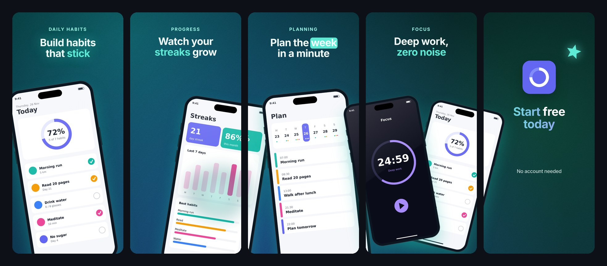
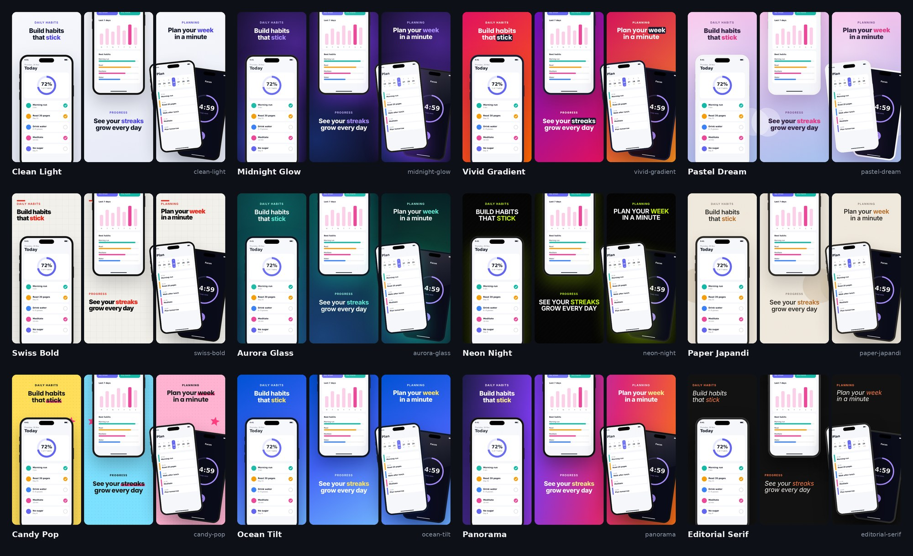
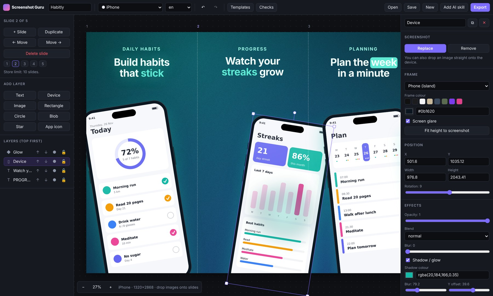
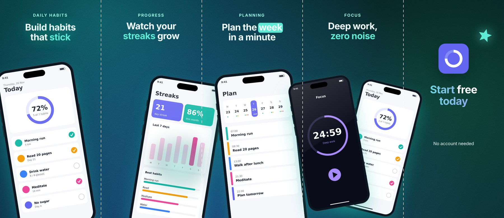
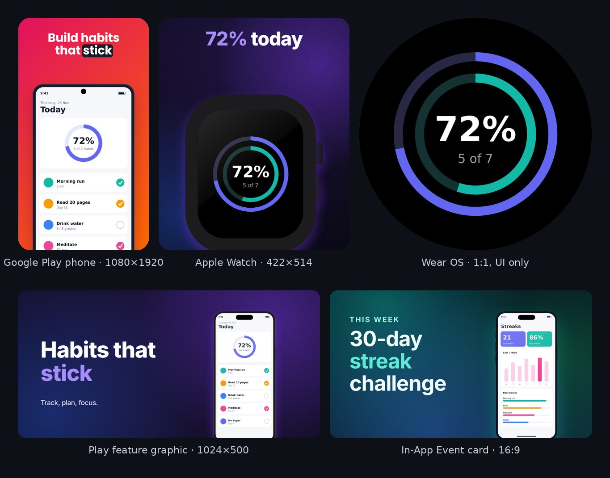
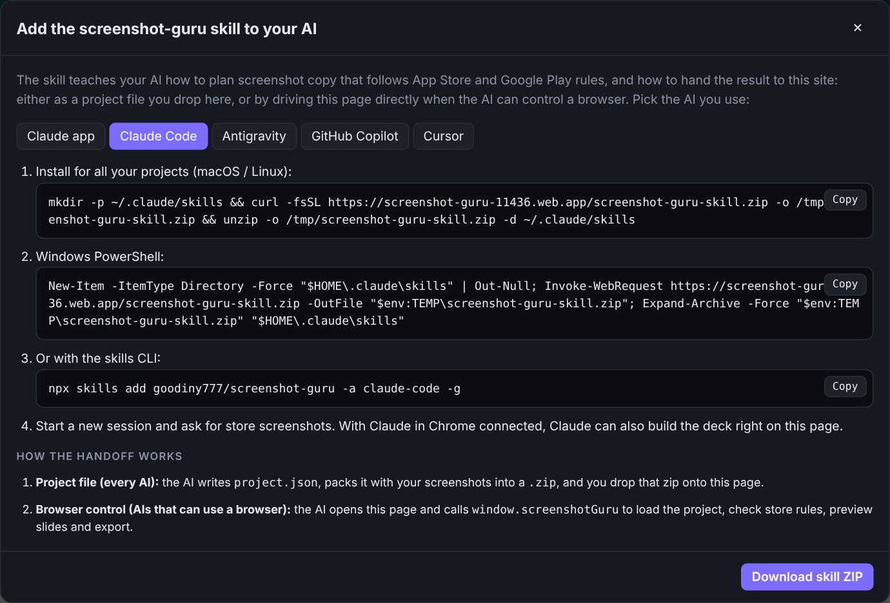

<div align="center">

# Screenshot Guru

**App Store and Google Play screenshots, made in your browser — with an AI skill that writes them for you.**

[](https://github.com/goodiny777/screenshot-guru/actions/workflows/ci.yml)
[](https://github.com/goodiny777/screenshot-guru/actions/workflows/deploy.yml)
[](LICENSE)
[](#use-it-with-your-ai)

### [Open the editor →](https://screenshot-guru-11436.web.app)



<sub>One deck, five store images. Every image on this page was rendered by the editor itself. "Habitly" is a made-up demo app.</sub>

</div>

---

## Why Screenshot Guru

- **Nothing to install, nothing uploaded.** Open the page and start. Rendering and export run in your browser; your images never leave your computer.
- **Every store size in one click.** 25 formats — iPhone, iPad, Apple Watch, Mac, Apple TV, Vision Pro, Android phone and tablets, Chromebook, Wear OS, Android TV, Android XR, feature graphic, In-App Events and promo banners — exported at the exact pixel sizes as opaque PNG or JPEG.
- **Store rules built in.** Slide limits, Wear OS "UI only" rules, safe areas, text contrast and missing translations are checked before you export.
- **Made for AI.** Install the skill in Claude, Antigravity, GitHub Copilot or Cursor. Your AI writes the headlines, picks a template and hands you a ready project.

## 12 templates

Pick a look, keep your words and screenshots. Switch templates at any time — layout, style or both.



| | | | |
|---|---|---|---|
| Clean Light | Midnight Glow | Vivid Gradient | Pastel Dream |
| Swiss Bold | Aurora Glass | Neon Night | Paper Japandi |
| Candy Pop | Ocean Tilt | Panorama | Editorial Serif |

Save your own designs as templates too, and reuse them on any device.

## Full control

Every slide is made of free layers you can move, resize and **rotate to any angle**.



- **Layers:** text, images, device frames (phone, tablet, watch, laptop, TV, browser, none), shapes (rectangle, circle, blob, star), your app icon.
- **Angles and position:** drag, resize, rotate with snapping (hold Shift for 15° steps), nudge with arrow keys, align to the slide centre.
- **Backgrounds:** solid, linear and radial gradients, light orbs, dots / grid / lines / waves, film grain, vignette — per slide or one across the whole set.
- **Effects:** shadows and glows, blur, opacity, blend modes, text outline, gradient text.
- **Headlines that pop:** wrap a word in `**double stars**` to highlight it as a colour, a marker or a pill. Text can shrink to fit.
- **Fonts:** 29 Google Fonts (including Noto for Arabic, Hebrew, Georgian, Japanese, Korean and Chinese) or upload your own.
- **Languages:** per-language headlines and screenshots, with fallback to your base language.
- **Undo / redo, autosave,** and save or open the whole project as one `.zip`.

### One connected canvas

All slides of a device sit side by side. A phone can cross from one slide into the next, and each exported image gets its own part — so the set reads as one story when people swipe.



## Every store size



<details>
<summary><b>All 25 formats and their export sizes</b></summary>

| App Store | Export sizes | Max |
|---|---|---|
| iPhone | 1320×2868, 1290×2796, 1260×2736, 1284×2778, 1242×2688, 1206×2622, 1179×2556 | 10 |
| iPad | 2064×2752, 2048×2732 | 10 |
| iPhone Duo outer / inner | 1398×2034 / 2007×2853 | 10 |
| Apple Watch | 422×514, 410×502, 416×496, 396×484, 368×448, 312×390 | 10 |
| Mac | 2880×1800, 2560×1600, 1440×900, 1280×800 | 10 |
| Apple TV | 3840×2160, 1920×1080 | 10 |
| Apple Vision Pro | 3840×2160 | 10 |

| Google Play | Export sizes | Max |
|---|---|---|
| Android phone | 1080×1920, 1440×2560 | 8 |
| Android 7" / 10" tablet | 1200×1920 / 1600×2560 | 8 |
| Chromebook | 1920×1080, 3840×2160 | 8 |
| Wear OS | 1080×1080, 384×384 | 8 |
| Android TV | 1920×1080, 3840×2160 | 8 |
| Android TV banner | 1280×720 | 1 |
| Android XR | 3840×2400 | 8 |
| Feature graphic | 1024×500 | 1 |

| Promo banners | Export sizes | Max |
|---|---|---|
| In-App Event card (16:9) | 1920×1080, 3840×2160 | 10 |
| In-App Event details (9:16) | 1080×1920, 2160×3840 | 10 |
| Play promotional content (16:9 and square) | 1920×1080, 1080×1080 | 10 |
| App Store search creative (3:2) | 3840×2560, 1920×1280 | 1 |
| App Store product page header (21:9) | 3840×1646 | 1 |
| App Store universal creative (16:9) | 5244×2950 | 1 |
| Promo story (9:16) | 1080×1920 | 10 |

Landscape is available for phones and tablets. Each format links its official Apple or Google spec in the editor; anything not confirmed there is marked **Check**.

</details>

Export gives you one zip, ready to upload slot by slot:

```
app-store/iphone/1320x2868/en/01.png
app-store/iphone/1320x2868/de/01.png
google-play/feature-graphic/1024x500/en/01.png
promo/in-app-event-card-horizontal/1920x1080/en/01.png
```

## Use it with your AI

The **screenshot-guru skill** teaches your AI assistant how to plan store screenshots that convert and follow the store rules, and how to hand the result to the editor.

### 1. Install the skill

Open the editor and click **Add AI skill** for step-by-step instructions, or use one of these:

| AI | Install |
|---|---|
| **Claude app** (web / desktop) | Download the [skill ZIP](https://screenshot-guru-11436.web.app/screenshot-guru-skill.zip) → **Customize → Skills → + → Upload a skill** |
| **Claude Code** | `npx skills add goodiny777/screenshot-guru -a claude-code -g` |
| **Cursor** | `npx skills add goodiny777/screenshot-guru -a cursor -g` |
| **GitHub Copilot** | `gh skill install goodiny777/screenshot-guru screenshot-guru` |
| **Antigravity** | unzip the [skill ZIP](https://screenshot-guru-11436.web.app/screenshot-guru-skill.zip) into `~/.gemini/config/skills/` |



### 2. Ask for screenshots

Give your AI your raw app screenshots and ask, for example:

> Make App Store and Google Play screenshots for my habit tracker with screenshot-guru. English and German. iPhone, Android phone, feature graphic and Wear OS.

The skill asks only for what is missing (your top benefits, a style), then:

1. Plans one benefit per slide, strongest first, with short headlines and one highlighted keyword.
2. Picks a template and the right device formats, and translates the copy.
3. Writes a `project.json` and packs it with your screenshots into a `.zip`.

### 3. Open it in the editor

Two ways, depending on your AI:

- **Project file (every AI):** drop the `.zip` onto [the editor](https://screenshot-guru-11436.web.app). All decks open fully designed. Adjust anything, then click **Export**.
- **Browser control (AIs that can use a browser):** the AI opens the editor and builds the deck live through `window.screenshotGuru`, checks the store rules, looks at the rendered slides and exports.

<details>
<summary><b>What the AI writes (short "recipe" format)</b></summary>

```json
{
  "schema": "screenshot-guru/1",
  "name": "Habitly",
  "locales": ["en", "de"],
  "icon": "assets/icon.png",
  "decks": {
    "iphone": {
      "template": "aurora-glass",
      "slides": [
        {
          "layout": "hero",
          "label": { "en": "DAILY HABITS", "de": "TÄGLICHE GEWOHNHEITEN" },
          "headline": { "en": "Build habits\nthat **stick**", "de": "Gewohnheiten,\ndie **bleiben**" },
          "screenshot": { "en": "assets/en/today.png", "de": "assets/de/today.png" }
        },
        { "layout": "span", "headline": "Watch your\n**streaks** grow", "screenshot": "assets/en/stats.png" }
      ]
    },
    "feature-graphic": { "template": "midnight-glow", "slides": [{ "headline": "Habits that **stick**", "screenshot": "assets/en/today.png" }] }
  }
}
```

The template does the layout; the AI only writes copy and chooses layouts. The full contract is a JSON Schema at [`/project.schema.json`](https://screenshot-guru-11436.web.app/project.schema.json), and the skill's `pack_project.py` checks the project against it before packing.

</details>

<details>
<summary><b>Browser API for agents</b></summary>

```js
await screenshotGuru.loadProject(recipe);           // or loadProjectZip(base64)
screenshotGuru.restyle("iphone", "neon-night");     // new look, same copy
screenshotGuru.setText("iphone", 0, "Headline", "Build habits\nthat **last**");
screenshotGuru.validate();                          // store-rule warnings
await screenshotGuru.renderSlide("iphone", 0, { width: 600 }); // PNG data URL to review
await screenshotGuru.exportZip();                   // every size, every language
```

Full reference: [`skills/screenshot-guru/references/browser-api.md`](skills/screenshot-guru/references/browser-api.md)

</details>

## Privacy

No accounts, no analytics, no server storage. Projects and images stay in your browser until you click **New** or clear site data. The only outside requests are for Google Fonts. Device frames are generic drawings; no Apple or Google artwork is used.

---

## For developers

```bash
npm install
npm run dev          # http://localhost:5173
npm run check        # lint + typecheck + skip gate + skill freshness + unit tests
npm run fixtures     # synthetic test fixtures
npm run test:e2e     # Playwright (set CHROME_PATH to use an installed Chrome)
npm run build        # regenerates skill references + skill zip + schema, then builds
```

**Stack:** Vite + React + TypeScript, one Canvas 2D renderer shared by preview and export, IndexedDB for storage, `fflate` + `fast-png` for the zip and opaque PNGs, `@cfworker/json-schema` for CSP-safe validation.

**Deploy:** pushes to `main` run CI, then deploy to Firebase Hosting and smoke-test the live site. Pull requests get a 7-day preview URL. Workflows only use the deploy key for code already on `main` in this repository.

```
src/model/     types, device catalogue, fonts, templates, project schema
src/render/    renderer, device frames, text layout, export + store checks
src/store/     state + undo, IndexedDB assets, project zip import/export
src/agent/     window.screenshotGuru (browser-control handoff)
src/ui/        React editor
skills/        the Agent Skill (device and template references are generated)
docs/          specs, architecture, user guide
```

**Docs:** [User guide](docs/user-guide.md) · [Architecture](docs/architecture/README.md)

Contributions are welcome. Please open an issue first for larger changes.

## Credits

Made by [Mikhail Babozhko](https://mbwork.info).

## License

[MIT](LICENSE)
