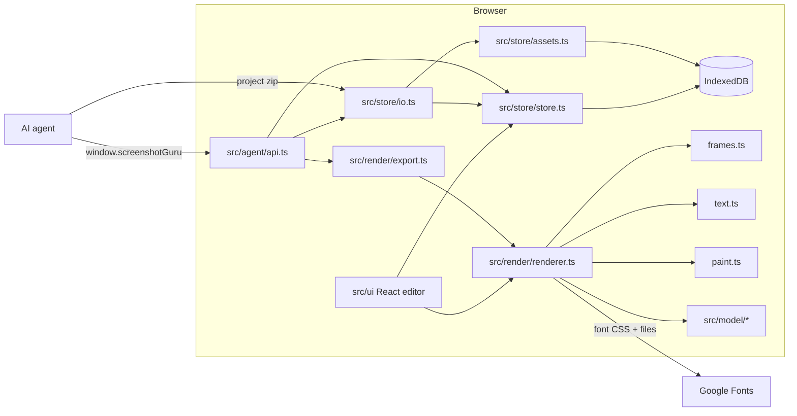

# Architecture

**As of:** 2026-11-26 — prototype, test harness, and deploy pipeline.

screenshot-guru is a static single-page app. All editing, rendering and exporting happens in the
user's browser. Firebase Hosting only serves files. The only outbound requests are to Google Fonts.

## 1. Components

| Module | Responsibility |
|---|---|
| `src/main.tsx` | Boot: installs the agent API, loads the saved project, registers uploaded fonts, mounts React |
| `src/model/types.ts` | Project, deck, slide, layer and recipe types — the in-app contract |
| `src/model/devices.ts` | Device catalogue: design canvas, export sizes, slide limits, store rules, safe areas |
| `src/model/fonts.ts` | Curated Google Fonts list; loads font CSS on demand and waits for faces |
| `src/model/defaults.ts` | Factories for layers, slides, decks; default frame and screen aspect per device |
| `src/model/templates.ts` | 12 styles; recipe expansion (`buildDeck`, `expandDeck`); `restyleDeck`; `extractRecipe` |
| `src/render/renderer.ts` | Draws a deck strip on Canvas 2D; the same code serves preview and export |
| `src/render/frames.ts` | Generic vector device frames and their screen rectangles |
| `src/render/text.ts` | Word wrap, `**highlight**` runs, auto-fit, outline |
| `src/render/paint.ts` | Paints, backgrounds (orbs, patterns, grain, vignette), colour and contrast helpers |
| `src/render/export.ts` | Exact-size slide render, opaque PNG/JPEG encode, zip bundle, store checks (`validate`) |
| `src/store/store.ts` | App state, undo/redo, debounced IndexedDB autosave, user templates, `adaptDeck` |
| `src/store/assets.ts` | Image and font Blobs in IndexedDB, decoded image cache, change notifications |
| `src/store/io.ts` | Project zip import (recipe or full format, asset path remapping) and export |
| `src/agent/api.ts` | `window.screenshotGuru`, the browser-control handoff for AI agents |
| `src/ui/App.tsx` | Top bar, keyboard shortcuts, project-file drop, dialogs, languages dialog |
| `src/ui/Stage.tsx` | Strip canvas, selection, drag/resize/rotate, snapping, image drop, safe areas, zoom |
| `src/ui/LeftPanel.tsx` | Slide controls, add-layer buttons, layer list |
| `src/ui/Inspector.tsx` | Layer properties, deck background, orientation, restyle, app settings |
| `src/ui/TemplatesDialog.tsx` | Built-in templates with live previews; user templates |
| `src/ui/ExportDialog.tsx` | Device/size/language/format choice, progress, store checks |
| `src/ui/SkillDialog.tsx` | Install steps for Claude, Claude Code, Antigravity, Copilot, Cursor |
| `src/ui/controls.tsx` | Form controls, paint and background editors, dialog shell, copy block |
| `src/ui/swatches.ts` | Colour swatches and CSS previews of paints |
| `src/ui/files.ts` | System file picker helper |
| `scripts/build-skill.mjs` | Generates skill references from source; packs a byte-stable skill zip |
| `scripts/check-skill-fresh.mjs` | CI gate: generated skill files match the source |
| `scripts/check-skips.mjs` | CI gate: every skipped test names a `BUG-NNN` |
| `scripts/serve-dist.mjs` | Serves `dist/` with `firebase.json` headers for production-like e2e |
| `scripts/smoke.mjs` | Live smoke for a deployed URL |

## 2. Rendering pipeline

1. A deck is a **strip**: slide *i* occupies x ∈ [i·W, (i+1)·W) in design pixels.
2. Background: one paint across the strip (`spanBackground`) or one per slide (slide override wins).
3. Layers belong to a slide and use slide-local coordinates; they may extend into neighbours.
   When drawing slides [a, b], layers of slides a−1 and b+1 are drawn too, so crossings are seamless.
4. Layer draw order: slides left to right, layers in list order (last on top).
5. Effects per layer: opacity → blend mode → rotation about the centre → blur → shadow/glow.
6. Device layers draw the frame body (casts the shadow), clip to the screen, draw the screenshot
   (cover, top-anchored), glare, then frame details (island, punch hole, rim).

## 3. Data model

See `src/model/types.ts`. Project → decks (one per device id) → slides → layers. Layers reference
assets by id. Text is a map of locale → string. Device and image layers may carry `assets`
(locale → asset id) for localized screenshots.

Two file formats are accepted on import (`src/store/io.ts`):

- **Recipe** (written by AI agents): template id + per-slide copy and screenshot paths; expanded by
  `expandDeck`. Documented in `skills/screenshot-guru/references/project-format.md`.
- **Full**: decks with slides and layers, as the editor saves them.

Image paths inside a zip are replaced with fresh asset ids on import.

## 4. Persistence

| Store | IndexedDB database / store | Content |
|---|---|---|
| Project | `screenshot-guru-state` / `kv` key `project` | the whole Project JSON, saved 400 ms after the last edit |
| User templates | `screenshot-guru-state` / `kv` key `templates` | array of saved decks |
| Assets | `screenshot-guru` / `assets` | image and font Blobs keyed by asset id |

Undo history is in memory only (100 steps).

## 5. Export

For each chosen device × size × locale × slide, `renderSlide` draws the slide on its own canvas at
the exact store size (scale = max of width and height ratios, centred), then `encodeCanvas` drops
the alpha channel and writes 24-bit PNG (fast-png) or JPEG. Files are zipped with fflate at level 0.
Path: `app-store|google-play|promo/<device>/<W>x<H>/<locale>/NN.png`.

`validate()` returns store-rule warnings (slide limits, Wear OS no text/frame, safe areas,
contrast, missing translations, headline length).

## 6. AI handoff

- **A — project file:** the skill writes a recipe `project.json`, `pack_project.py` zips it with
  the images, the user drops the zip on the page.
- **C — browser control:** an agent that can drive a browser opens the site and calls
  `window.screenshotGuru` (`skills/screenshot-guru/references/browser-api.md`).

## 7. Devices and templates

The device list and template list are generated into the skill
(`skills/screenshot-guru/references/devices.md`, `templates.md`) by `npm run skill`.
CI fails if they are stale.

## 8. Hosting and delivery

| Item | Value |
|---|---|
| Firebase project | `screenshot-guru-11436` (Analytics off, Gemini off) |
| Live URL | https://screenshot-guru-11436.web.app |
| Headers | CSP (self + Google Fonts; `https:` for agent URL imports), nosniff, referrer policy, permissions policy; hashed assets `immutable`; HTML `no-cache` |
| CI | `.github/workflows/ci.yml`: lint, typecheck, skip gate, skill freshness, unit, e2e (2 locale projects + production-header server) |
| Deploy | `deploy.yml` after CI on `main`; `preview.yml` per PR; both run `scripts/smoke.mjs` |
| Secret | `FIREBASE_SERVICE_ACCOUNT_SCREENSHOT_GURU_11436` |
